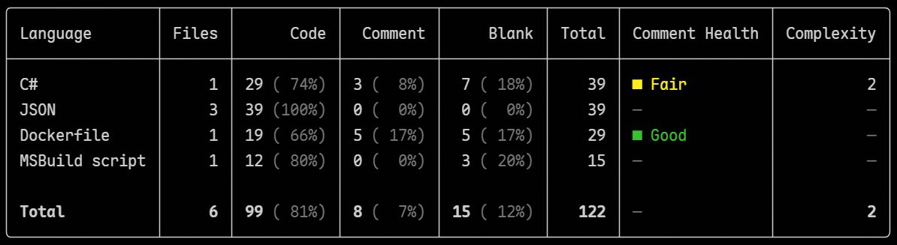
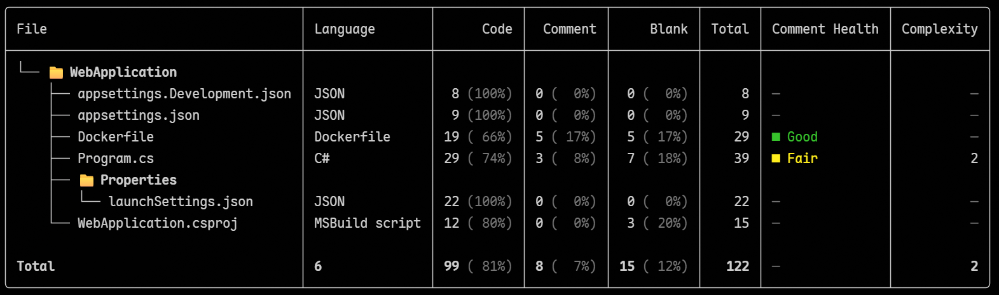

# Sloc

[](https://github.com/coldhighsun/Sloc/actions/workflows/ci.yml)
[](https://codecov.io/gh/coldhighsun/Sloc)

[](LICENSE)
[](https://www.nuget.org/packages/Sloc)


[](https://github.com/coldhighsun/Sloc/releases/latest)
[](https://github.com/coldhighsun/Sloc/releases)

[](https://www.nuget.org/packages/Sloc)
[](https://github.com/coldhighsun/Sloc/releases)

---

English | [中文](README.zh-CN.md)

Sloc (**S**ource **L**ines **O**f **C**ode) is a .NET global command-line tool for counting lines of source code.

## Features

- Count code / comment / blank / total lines
- Correctly handles single-line comments, block comments, and multi-line block comments
- Built-in comment rules for 66 common languages (auto-detected by file extension or name, e.g. `Makefile`, `Dockerfile`, `CMakeLists.txt`)
- Recursive directory scanning with `--include` / `--exclude` glob filters
- Automatically excludes `bin`, `obj`, `artifacts`, `.git`, `.vs`, `.vscode`, `.idea`, `node_modules`, and similar directories by default
- Five output formats: colored table (default), JSON, HTML, CSV, and Markdown
- Comment Health column in table output showing comment-density indicator (None / Low / Fair / Good / High / Dense)
- Format auto-detected from the `--output` file extension (`.json` → JSON, `.html` / `.htm` → HTML)
- Honors `.gitignore` files (including nested ones, and, when `path` is inside a git repository, the ones in the directories above it up to the repository root) by default; `--no-gitignore` disables it
- Parallel analysis across CPU cores (`--jobs`), with deterministic output
- CI-friendly: JSON to stdout for piping (e.g. `| jq`), meaningful exit codes, and a `--min-comment-pct` threshold gate
- Compare against a saved JSON report with `--baseline`, or directly against another commit with `--compare-to`, to see how line counts changed
- Sort and limit the language summary with `--sort` (including by comment percentage) / `--top`
- Files or directories that cannot be read, and binary files (detected by NUL bytes), are skipped gracefully; a summary of skipped paths and reasons is shown at the end (in every format except `Csv`, which stays a single machine-parsable table)

## Installation

Install via [winget](https://learn.microsoft.com/windows/package-manager/winget/) (Windows):

```bash
winget install coldhighsun.sloc
```

Or install as a .NET global tool (requires .NET 10 SDK):

```bash
dotnet tool install --global Sloc
```

Update or uninstall:

```bash
winget upgrade coldhighsun.sloc
winget uninstall coldhighsun.sloc

dotnet tool update --global Sloc
dotnet tool uninstall --global Sloc
```

## Usage

```bash
sloc <path> [options]
```

### Examples

```bash
# Count current directory (recursive)
sloc .

# Count a specific directory
sloc ./src

# Count a single file
sloc ./src/Program.cs

# Only count C# files
sloc ./src --include "**/*.cs"

# Exclude test directories
sloc . --exclude "**/tests/**"

# Show per-file details
sloc ./src --by-file

# Output as JSON
sloc ./src --format json

# Save results as an HTML report (opens in a browser)
sloc ./src --format html --output report.html

# HTML printed to stdout (default when --output is omitted)
sloc ./src --format html

# Auto-detect format from file extension
sloc ./src --output sloc-report.json

# Include files with unknown extensions
sloc . --all

# Do not recurse into subdirectories
sloc ./src --no-recursive

# Exclude a directory by name, at any depth
sloc . --exclude-dir vendor

# Watch for file changes and live-refresh the table
sloc ./src --watch

# Count byte-identical files only once
sloc . --unique

# Pipe JSON to jq
sloc . --format json | jq .total

# Fail CI if comments are below 10% of lines
sloc . --min-comment-pct 10

# Save a baseline, then diff a later run against it
sloc . --format json --output baseline.json
sloc . --baseline baseline.json

# Diff the current working tree directly against a commit, no baseline file needed
sloc . --compare-to HEAD~5

# Diff two commits directly, without checking either out
sloc . --git-hash HEAD --compare-to main

# Analyze a specific commit's tree without checking it out
sloc . --git-hash v1.2.0

# Analyze exactly the files listed in a text file
sloc --list-file files.txt

# Sort by comment lines and show only the top 5 languages
sloc . --sort comment --top 5

# Sort by comment percentage, descending
sloc . --sort commentpct

# Markdown report with both language summary and per-file breakdown, printed to stdout
sloc . --format markdown --detailed -o -
```

### Options

| Option | Short | Description |
| --- | --- | --- |
| `path` (argument) | | File or directory to analyze, defaults to current directory `.`. Running `sloc` with no arguments at all shows help instead. |
| `--list-file` | | Analyze exactly the files listed one-per-line in this file instead of scanning `path`; use `-` to read the list from stdin |
| `--include` | `-i` | File glob pattern to include, can be specified multiple times |
| `--exclude` | `-e` | File glob pattern to exclude, can be specified multiple times |
| `--exclude-dir` | | Directory name to exclude at any depth (e.g. `vendor`); shorthand for `--exclude "**/<name>/**"`, can be specified multiple times |
| `--include-lang` | | Language display name to include (e.g. `"C#"`), matched case-insensitively; can be specified multiple times |
| `--exclude-lang` | | Language display name to exclude, matched case-insensitively; can be specified multiple times |
| `--unique` | | Count byte-identical files only once; later duplicates are reported as skipped |
| `--format` | `-f` | Output format: `Table` (default), `Json`, `Html`, `Csv`, or `Markdown` |
| `--output` | `-o` | Output file path for `Json` / `Html` / `Csv` / `Markdown` formats; use `-` to write to stdout; format is inferred from the file extension when `--format` is not specified |
| `--no-recursive` | | Do not recurse into subdirectories |
| `--no-health` | | Hide the Comment Health column and percentage breakdowns |
| `--by-file` | | Show per-file details in addition to the language summary |
| `--detailed` | | In `Json` / `Html` / `Markdown` output, include both the language summary and the per-file breakdown. In `Csv` output it selects the language summary only (a single well-formed table) |
| `--paged` | `-p` | Show paged output |
| `--all` | | Include files with unknown extensions (grouped as `Other`) |
| `--quiet` | `-q` | Suppress the banner, progress UI, and `Saved to` message |
| `--no-progress` | | Suppress the live table and progress bar |
| `--watch` | `-w` | Watch the path for file changes and re-run the analysis, refreshing the table (Table format only; press Ctrl+C to stop) |
| `--min-comment-pct` | | Fail (exit code `2`) if the overall comment percentage is below this value |
| `--jobs` | `-j` | Max files to analyze in parallel (default: processor count; `1` = sequential) |
| `--no-gitignore` | | Do not honor `.gitignore` files (they are respected by default, including those above `path` in its repository, the repository's `info/exclude`, and the global `core.excludesFile`); also scans nested repositories such as submodules, which are otherwise skipped (and listed as skipped) when `path` is inside a repository (`--compare-to` always skips them, since the commit holds none of their files) |
| `--no-gitattributes` | | Do not honor `.gitattributes` files (`linguist-vendored`/`linguist-generated` files are excluded by default, including by the `.gitattributes` files above `path` in its repository) |
| `--git-hash` | | Analyze the repository tree as of this commit/tree-ish, without checking it out; `path` is used as the repo root; requires `git` on `PATH`; symlinked and submodule tree entries are skipped; files with a smudge filter (e.g. Git LFS) or a `working-tree-encoding` attribute are converted as a checkout would (Git LFS may download objects), and a file whose filter fails is skipped; `--include`/`--exclude`, `--no-recursive`, `--follow-symlinks`, `--no-gitignore`, and `--no-gitattributes` have no effect in this mode; mutually exclusive with `--list-file` |
| `--follow-symlinks` | | Include symlinked/junctioned directories and symlinked files instead of skipping them; a directory symlink that loops back to one of its own ancestors (or points at a directory containing one) is still skipped, as is a link whose target is already inside `path`; a file reached through several links is counted once |
| `--baseline` | | Compare against a previously saved JSON report and show the line-count diff |
| `--compare-to` | | Diff the current analysis against `path` as of this other commit/tree-ish, without checking it out or saving a baseline file first; requires `git` on `PATH`; `path` may be a directory or a single file; the commit's files are filtered the same way as the working tree (`--include`/`--exclude`, `.gitignore`, `.gitattributes`, …) so unchanged files diff to zero; combine with `--git-hash` to diff two commits directly; mutually exclusive with `--baseline`, `--watch`, and `--list-file` |
| `--sort` | | Order the language summary by `Total` (default), `Code`, `Comment`, `Blank`, `Files`, `Name`, or `CommentPct` |
| `--top` | | Show only the top N languages in the summary; totals still cover all languages (noted in Table/Markdown/Html output, and as `languageCount` in Json) |
| `--no-update-check` | | Do not check GitHub for a newer release (checked by default, with a 2 second timeout) |
| `--help` | `-h` | Show help |
| `--version` | | Show version |

Supported language display names (for `--include-lang`/`--exclude-lang`):

`Assembly`, `Astro`, `BASIC`, `Batch`, `Bazel/Starlark`, `C`, `C#`, `C# Designer`, `C++`, `Clojure`, `CMake`, `Crystal`, `CSS`, `D`, `Dart`, `Dockerfile`, `Elixir`, `Elm`, `Erlang`, `F#`, `Go`, `GraphQL`, `Groovy`, `Haskell`, `HTML`, `INI`, `Java`, `JavaScript`, `JSON`, `Julia`, `Jupyter Notebook`, `Kotlin`, `Lua`, `Makefile`, `Markdown`, `MDX`, `MSBuild script`, `Nim`, `Nix`, `Objective-C`, `OCaml`, `Pascal`, `Perl`, `PHP`, `PowerShell`, `Protobuf`, `Python`, `R`, `Ruby`, `Rust`, `Scala`, `SCSS/Less`, `Shell`, `Solidity`, `SQL`, `Svelte`, `Swift`, `Terraform`, `Text`, `TOML`, `TypeScript`, `Visual Basic`, `Vue`, `XML`, `YAML`, `Zig`

All non-table formats (`Json`, `Html`, `Csv`, `Markdown`) are written to stdout by default (so they can be piped, e.g. `sloc . -f json | jq`); pass `--output <path>` to write a file instead.

`.gitignore` files (including nested ones) are honored by default; pass `--no-gitignore` to disable. Save a JSON report and pass it to `--baseline` on a later run to see how line counts changed, or skip the saved report entirely and pass a commit/tree-ish to `--compare-to`. Diff output (from either `--baseline` or `--compare-to`) is only rendered as a console table or as JSON (`-f json`); other formats fall back to the table.

### Exit Codes

| Code | Meaning |
| --- | --- |
| `0` | Success |
| `1` | Path not found or unreadable, or invalid command-line arguments |
| `2` | A threshold (e.g. `--min-comment-pct`) was not met |
| `3` | Unexpected error |

### Sample Output



With `--by-file` (tree view per file):



## Supported Languages

- **Programming languages**: C#, C# Designer, C, C++, Java, Kotlin, Swift, JavaScript, TypeScript, Python, Go, Rust, PHP, Ruby, F#, Visual Basic, Scala, Dart, R, Lua, Perl, Elixir, Haskell, Objective-C, Groovy, Julia, Clojure, BASIC, Pascal, Zig, Nim, OCaml, Erlang, Elm, D, Crystal, Solidity
- **Web & templates**: HTML, CSS, SCSS/Less, Vue, Svelte, Astro, MDX
- **Data & config formats**: JSON, YAML, XML, TOML, INI, Markdown, Protobuf, GraphQL
- **Shell, build & infra**: Shell, PowerShell, Batch, SQL, Makefile, Dockerfile, CMake, Terraform, Bazel/Starlark, Nix, MSBuild script
- **Other**: Assembly, Jupyter Notebook, Text

Files without an extension (e.g. `Makefile`, `Dockerfile`, `CMakeLists.txt`, `Rakefile`, `Gemfile`) are recognized by name.

> Files with unknown extensions are grouped as `Other` when using `--all`, with only code lines and blank lines distinguished.

## Building from Source

```bash
# Restore and build
dotnet build

# Run tests
dotnet test

# Pack as a NuGet tool package (output to ./nupkg)
dotnet pack src/Sloc.Cli/Sloc.Cli.csproj -c Release -o ./nupkg

# Install from local package and verify
dotnet tool install --global --add-source ./nupkg Sloc
sloc ./src
```

## Known Limitations

- Line classification is based on text matching of comment symbols, not a full lexer.
- String literals are recognized for most languages, so comment markers inside strings (e.g. `"// not a comment"`) are counted as code, and escaped quotes are handled, including C# verbatim strings (`@"…""…"`), C# raw string literals and Java text blocks (`"""…"""`), Rust raw strings (`r"…"`, `r#"…"#`), and C++ raw strings (`R"(…)"`). Rust raw strings with more than one `#`, C# raw strings delimited by four or more quotes, and C++ raw strings with a custom delimiter (`R"x(…)x"`) are not modeled, and interpolation expressions inside strings are not analyzed. C/C++ digit separators (`1'000`) are not mistaken for character literals.
- Shell strings do not span lines, so a line starting with `#` inside a multi-line string, heredoc, or awk script is counted as a comment.
- Lua long-bracket comments are recognized up to level 4 (`--[====[ … ]====]`), and Perl POD blocks only when opened by a common command (`=pod`, `=head1`–`=head6`, `=over`, `=item`, `=back`, `=begin`, `=end`, `=for`, `=encoding`) at column 0.
- JavaScript/TypeScript regex literals are recognized, so comment markers inside them (e.g. `/\/*$/`) are counted as code, and PHP 8 attributes (`#[…]`) are code rather than `#` comments.
- Python triple-quoted strings are counted as comments only when they begin a statement (docstrings, including `r"""…"""`/`u"""…"""`); used as a value (e.g. `x = """…"""`), inside brackets left open by an earlier line, or after a trailing `\` line continuation they are counted as code.
- The complexity metric counts branch tokens textually, so a token that is not a branch in context still adds to it: TypeScript's optional-member `?:` (`name?: string`), Rust's empty closure parameter list `||` (`|| x`), and C++'s rvalue/forwarding reference `&&` (`T&&`).

## License

This project is released under the [MIT License](https://opensource.org/licenses/MIT).
