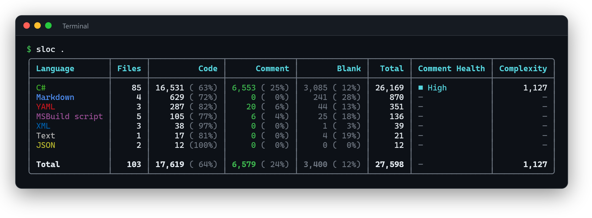
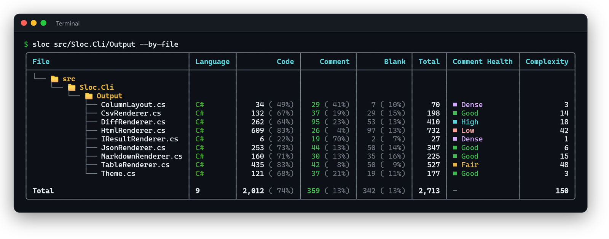

# Sloc

[](https://github.com/coldhighsun/Sloc/actions/workflows/ci.yml)
[](https://codecov.io/gh/coldhighsun/Sloc)
[](https://github.com/coldhighsun/Sloc/actions/workflows/ci.yml)

[](LICENSE)

[](https://www.nuget.org/packages/Sloc)


[](https://github.com/coldhighsun/Sloc/releases/latest)
[](https://github.com/coldhighsun/Sloc/releases)
[](https://www.nuget.org/packages/Sloc)
[](https://github.com/coldhighsun/Sloc/releases)

---

[English](README.md) | [简体中文](README.zh-CN.md) | 繁體中文

Sloc（**S**ource **L**ines **O**f **C**ode）是一個用於統計原始碼行數的 .NET 全域命令列工具。

## 功能特色

- 統計程式碼行 / 註解行 / 空白行 / 總行數
- 正確處理單行註解、區塊註解以及跨多行的區塊註解
- 內建 78 種常見語言的註解規則（依檔案副檔名或檔名自動辨識，如 `Makefile`、`Dockerfile`、`CMakeLists.txt`）
- 遞迴掃描目錄，支援 `--include` / `--exclude` glob 篩選
- 預設排除 `bin`、`obj`、`artifacts`、`.git`、`.vs`、`.vscode`、`.idea`、`node_modules` 等目錄
- 五種輸出格式：彩色表格（預設）、JSON、HTML、CSV 與 Markdown
- 表格輸出新增註解健康度欄位，顯示註解密度指標（無 / 低 / 一般 / 良好 / 較高 / 過密）
- 未指定 `--format` 時，可根據 `--output` 檔案副檔名自動推斷格式（`.json` → JSON，`.html` / `.htm` → HTML）
- 預設遵循 `.gitignore` 檔案（含子目錄中的；`path` 位於 git 儲存庫內時，也包括其上層直到儲存庫根目錄的）；`--no-gitignore` 可停用
- 跨 CPU 核心平行分析（`--jobs`），輸出保持確定性
- 適用於 CI：JSON 可輸出到標準輸出以便透過管線處理（例如 `| jq`）、提供有意義的結束代碼，以及 `--min-comment-pct` 門檻檢查
- 透過 `--baseline` 與已儲存的 JSON 報告比較，或用 `--compare-to` 直接與另一個 commit 比較，查看行數變化
- 透過 `--sort`（支援依註解佔比排序）/ `--top` 對語言彙總排序並限制筆數
- 無法讀取的檔案或目錄，以及二進位檔案（透過 NUL 位元組偵測），會被自動略過，並在最終結果中列出所有略過的路徑及原因（除 `Csv` 外的所有格式；CSV 保持為單一份可供機器解析的表格）

## 安裝

透過 [winget](https://learn.microsoft.com/windows/package-manager/winget/) 安裝（Windows）：

```bash
winget install coldhighsun.sloc
```

透過 [Homebrew](https://brew.sh/) 安裝（macOS / Linux）：

```bash
brew install coldhighsun/tap/sloc
```

或作為 .NET 全域工具安裝（需要 .NET 10 SDK）：

```bash
dotnet tool install --global Sloc
```

更新或解除安裝：

```bash
winget upgrade coldhighsun.sloc
winget uninstall coldhighsun.sloc

brew upgrade sloc
brew uninstall sloc

dotnet tool update --global Sloc
dotnet tool uninstall --global Sloc
```

## 使用方式

```bash
sloc <path> [options]
```

### 範例

```bash
# 統計目前目錄（遞迴）
sloc .

# 統計指定目錄
sloc ./src

# 統計單一檔案
sloc ./src/Program.cs

# 僅統計 C# 檔案
sloc ./src --include "**/*.cs"

# 排除測試目錄
sloc . --exclude "**/tests/**"

# 顯示逐檔明細
sloc ./src --by-file

# 以 JSON 格式輸出
sloc ./src --format json

# 儲存為 HTML 報告（可在瀏覽器中開啟）
sloc ./src --format html --output report.html

# HTML 輸出到標準輸出（省略 --output 時的預設行為）
sloc ./src --format html

# 根據檔案副檔名自動推斷格式
sloc ./src --output sloc-report.json

# 包含未知副檔名的檔案
sloc . --all

# 不遞迴子目錄
sloc ./src --no-recursive

# 依名稱排除任意深度的目錄
sloc . --exclude-dir vendor

# 監看檔案變化並即時重新整理表格
sloc ./src --watch

# 內容位元組完全相同的檔案只計一次
sloc . --unique

# 將 JSON 透過管線傳給 jq
sloc . --format json | jq .total

# 若註解佔比低於 10% 則讓 CI 失敗
sloc . --min-comment-pct 10

# 儲存基準線，之後與後續執行比較
sloc . --format json --output baseline.json
sloc . --baseline baseline.json

# 直接與某個 commit 比較目前工作目錄，無需先儲存基準線檔案
sloc . --compare-to HEAD~5

# 直接比較兩個 commit，無需簽出任何一個
sloc . --git-hash HEAD --compare-to main

# 分析某個 commit 時的樹狀態，無需簽出
sloc . --git-hash v1.2.0

# 分析文字檔中逐行列出的檔案清單
sloc --list-file files.txt

# 依註解行排序，僅顯示前 5 種語言
sloc . --sort comment --top 5

# 依註解佔比降冪排序
sloc . --sort commentpct

# 產生同時包含語言彙總和逐檔明細的 Markdown 報告，輸出到標準輸出
sloc . --format markdown --detailed -o -
```

### 選項

| 選項 | 簡寫 | 說明 |
| --- | --- | --- |
| `path`（引數） | | 要分析的檔案或目錄，預設為目前目錄 `.`。不帶任何引數執行 `sloc` 時會顯示說明。 |
| `--list-file` | | 分析該檔案中逐行列出的檔案清單，而不是掃描 `path`；用 `-` 表示從標準輸入讀取清單 |
| `--include` | `-i` | 要包含的檔案 glob 模式，可多次指定 |
| `--exclude` | `-e` | 要排除的檔案 glob 模式，可多次指定 |
| `--exclude-dir` | | 要在任意深度排除的目錄名稱（如 `vendor`）；等同於 `--exclude "**/<name>/**"`，可多次指定 |
| `--include-lang` | | 要包含的語言顯示名稱（如 `"C#"`），不分大小寫比對；可多次指定 |
| `--exclude-lang` | | 要排除的語言顯示名稱，不分大小寫比對；可多次指定 |
| `--unique` | | 內容位元組完全相同的檔案只計一次；後出現的重複檔案計入略過清單 |
| `--format` | `-f` | 輸出格式：`Table`（預設）、`Json`、`Html`、`Csv` 或 `Markdown` |
| `--output` | `-o` | `Json` / `Html` / `Csv` / `Markdown` 格式的輸出檔案路徑；用 `-` 表示寫到標準輸出；未指定 `--format` 時根據檔案副檔名自動推斷格式 |
| `--no-recursive` | | 不遞迴掃描子目錄 |
| `--no-health` | | 隱藏註解健康度欄位及百分比資料 |
| `--by-file` | | 在語言彙總之外額外顯示逐檔明細 |
| `--detailed` | | 在 `Json` / `Html` / `Markdown` 輸出中同時包含語言彙總和逐檔明細；在 `Csv` 輸出中僅選擇語言彙總（保持單一份規範表格） |
| `--paged` | `-p` | 顯示分頁輸出 |
| `--all` | | 包含副檔名未知的檔案（歸入 `Other`） |
| `--quiet` | `-q` | 抑制橫幅、進度介面和 `Saved to` 提示 |
| `--no-progress` | | 抑制即時表格和進度列 |
| `--watch` | `-w` | 監看路徑下的檔案變化並自動重新分析，重新整理表格（僅支援 Table 格式；按 Ctrl+C 停止） |
| `--min-comment-pct` | | 若整體註解佔比低於該值，則失敗（結束代碼 `2`） |
| `--jobs` | `-j` | 平行分析的最大檔案數（預設為處理器核心數；`1` 表示序列執行） |
| `--no-gitignore` | | 不遵循 `.gitignore` 檔案（預設遵循，包括 `path` 所在儲存庫中其上層目錄的 `.gitignore`、儲存庫的 `info/exclude` 以及全域 `core.excludesFile`）；同時會掃描子模組等巢狀儲存庫——預設情況下，`path` 位於儲存庫內時它們會被略過（並列入略過清單）（`--compare-to` 一律略過它們，因為 commit 中不包含其檔案） |
| `--no-gitattributes` | | 不遵循 `.gitattributes` 檔案（預設會排除標記為 `linguist-vendored`/`linguist-generated` 的檔案，包括由 `path` 所在儲存庫中其上層目錄的 `.gitattributes` 標記的） |
| `--git-hash` | | 分析儲存庫在該 commit/tree-ish 時的樹狀態，無需簽出；`path` 作為儲存庫根目錄；需要 `git` 在 `PATH` 中；符號連結與子模組項目會被略過；帶有 smudge 過濾器（如 Git LFS）或 `working-tree-encoding` 屬性的檔案會像簽出時一樣轉換（Git LFS 可能會下載物件），過濾器失敗的檔案會被略過；此模式下 `--include`/`--exclude`、`--no-recursive`、`--follow-symlinks`、`--no-gitignore`、`--no-gitattributes` 均不生效；與 `--list-file` 互斥 |
| `--follow-symlinks` | | 包含符號連結/接合點目錄以及符號連結檔案，而不是略過它們；指向自身祖先目錄（或包含祖先目錄的目錄）的循環連結仍會被略過，目標已位於 `path` 內的連結同樣略過；經多個連結到達的同一檔案只統計一次 |
| `--baseline` | | 與之前儲存的 JSON 報告比較，顯示行數增減 |
| `--compare-to` | | 將目前分析與 `path` 在另一個 commit/tree-ish 時的狀態比較，無需簽出該 commit 或先儲存基準線檔案；需要 `git` 在 `PATH` 中；`path` 可以是目錄或單一檔案；該 commit 的檔案會按與工作目錄相同的規則篩選（`--include`/`--exclude`、`.gitignore`、`.gitattributes` 等），未改動的檔案差異為零；可與 `--git-hash` 組合直接比較兩個 commit；與 `--baseline`、`--watch`、`--list-file` 互斥 |
| `--sort` | | 語言彙總排序依據：`Total`（預設）、`Code`、`Comment`、`Blank`、`Files`、`Name` 或 `CommentPct` |
| `--top` | | 僅顯示彙總中排名前 N 的語言；合計仍包含所有語言（Table/Markdown/Html 輸出會註明，Json 輸出為 `languageCount` 欄位） |
| `--no-update-check` | | 不檢查 GitHub 上是否有新版本（預設檢查，逾時時間為 2 秒） |
| `--help` | `-h` | 顯示說明 |
| `--version` | | 顯示版本 |

支援的語言顯示名稱（用於 `--include-lang`/`--exclude-lang`）：

`Assembly`, `Astro`, `BASIC`, `Batch`, `Bazel/Starlark`, `C`, `C#`, `C# Designer`, `C++`, `Clojure`, `CMake`, `Crystal`, `CSS`, `D`, `Dart`, `Dockerfile`, `Elixir`, `Elm`, `Erlang`, `F#`, `Go`, `GraphQL`, `Groovy`, `Haskell`, `HTML`, `INI`, `Java`, `JavaScript`, `JSON`, `Julia`, `Jupyter Notebook`, `Kotlin`, `Lua`, `Makefile`, `Markdown`, `MDX`, `MSBuild script`, `Nim`, `Nix`, `Objective-C`, `OCaml`, `Pascal`, `Perl`, `PHP`, `PowerShell`, `Protobuf`, `Python`, `R`, `Ruby`, `Rust`, `Scala`, `SCSS/Less`, `Shell`, `Solidity`, `SQL`, `Svelte`, `Swift`, `Terraform`, `Text`, `TOML`, `TypeScript`, `Visual Basic`, `Vue`, `XML`, `YAML`, `Zig`

所有非表格格式（`Json`、`Html`、`Csv`、`Markdown`）預設都會輸出到標準輸出（便於透過管線處理，例如 `sloc . -f json | jq`）；傳入 `--output <路徑>` 則寫入檔案。

預設遵循 `.gitignore` 檔案（含子目錄中的）；傳入 `--no-gitignore` 可停用。先儲存一份 JSON 報告，之後用 `--baseline` 傳入即可查看行數變化，也可以跳過儲存報告這一步，直接把 commit/tree-ish 傳給 `--compare-to`。差異輸出（無論來自 `--baseline` 還是 `--compare-to`）僅支援主控台表格或 JSON（`-f json`）輸出；其他格式會回退為表格。

### 結束代碼

| 代碼 | 含義 |
| --- | --- |
| `0` | 成功 |
| `1` | 路徑不存在或無法讀取，或命令列引數無效 |
| `2` | 未達到門檻（如 `--min-comment-pct`） |
| `3` | 非預期錯誤 |

### 輸出範例



使用 `--by-file` 選項（依檔案以樹狀呈現）：



## 支援的語言

- **程式語言**：C#、C# Designer、C、C++、Java、Kotlin、Swift、JavaScript、TypeScript、Python、Go、Rust、PHP、Ruby、F#、Visual Basic、Scala、Dart、R、Lua、Perl、Elixir、Haskell、Objective-C、Groovy、Julia、Clojure、BASIC、Pascal、Zig、Nim、OCaml、Erlang、Elm、D、Crystal、Solidity、Fortran、COBOL、Scheme、Racket、Common Lisp、Emacs Lisp、Verilog、SystemVerilog、VHDL
- **前端與範本**：HTML、Razor、XAML、CSS、SCSS/Less、Vue、Svelte、Astro、MDX
- **資料與設定格式**：JSON、YAML、XML、TOML、INI、Markdown、TeX、Protobuf、GraphQL
- **指令碼、建置與基礎設施**：Shell、PowerShell、Batch、SQL、Makefile、Dockerfile、CMake、Terraform、Bazel/Starlark、Nix、MSBuild script
- **其他**：Assembly、Jupyter Notebook、Text

無副檔名的檔案（如 `Makefile`、`Dockerfile`、`CMakeLists.txt`、`Rakefile`、`Gemfile`）依檔名辨識。

> 副檔名未知的檔案在使用 `--all` 時會被歸入 `Other` 類別，僅區分程式碼行與空白行。

## 從原始碼建置

```bash
# 還原與建置
dotnet build

# 執行測試
dotnet test

# 封裝為 NuGet 工具套件（輸出到 ./nupkg）
dotnet pack src/Sloc.Cli/Sloc.Cli.csproj -c Release -o ./nupkg

# 從本機套件安裝並驗證
dotnet tool install --global --add-source ./nupkg Sloc
sloc ./src
```

## 已知限制

- 行的分類基於註解符號的文字比對，不是完整的詞法分析器。
- 大多數語言已辨識字串常值，因此字串內部的註解符號（例如 `"// 這不是註解"`）會被計為程式碼，跳脫引號也能正確處理，包括 C# 逐字字串（`@"…""…"`）、C# 原始字串與 Java 文字區塊（`"""…"""`）、Rust 原始字串（`r"…"`、`r#"…"#`）以及 C++ 原始字串（`R"(…)"`）。帶多個 `#` 的 Rust 原始字串、以四個及以上引號定界的 C# 原始字串和帶自訂定界符的 C++ 原始字串（`R"x(…)x"`）暫不支援，字串內的插值運算式也不做分析。C/C++ 數字分隔符（`1'000`）不會被誤認為字元常值。
- Lua 長括號註解最多辨識到第 4 級（`--[====[ … ]====]`）；Perl POD 區塊僅在第 0 欄以常見指令（`=pod`、`=head1`–`=head6`、`=over`、`=item`、`=back`、`=begin`、`=end`、`=for`、`=encoding`）開頭時辨識。
- 已辨識 JavaScript/TypeScript 正規表示式常值，因此其中的註解符號（例如 `/\/*$/`）會被計為程式碼；PHP 8 屬性（`#[…]`）計為程式碼，而不是 `#` 註解。
- Python 三引號字串僅在作為陳述式開頭（docstring，包括 `r"""…"""`/`u"""…"""`）時計為註解；作為值使用時（例如 `x = """…"""`）、位於前面行未閉合的括號內或跟在行尾 `\` 續行之後時計為程式碼。
- 複雜度指標按文字統計分支記號，因此在上下文中並非分支的同名記號也會計入：TypeScript 可選成員的 `?:`（`name?: string`）、Rust 空參數閉包的 `||`（`|| x`）以及 C++ 右值/轉發參考的 `&&`（`T&&`）。

- Fortran 與 COBOL 僅辨識自由格式（`!` 與 `*>` 註解）；固定格式註解（Fortran 第 1 欄的 `C`/`*`，COBOL 第 7 欄的 `*`）會被計為程式碼。
- `.xaml`/`.axaml` 檔案現在歸為 `XAML`（先前歸入 `XML`），因此 `--include-lang`/`--exclude-lang XML` 以及在此變更之前儲存的基線會看到它們的歸屬變化。`.v`（Coq 或 Verilog）、`.cl`（OpenCL）與 `.cls`（Apex、VB6）不歸入任何語言。

## 授權條款

本專案基於 [MIT 授權條款](https://opensource.org/licenses/MIT) 發布。
